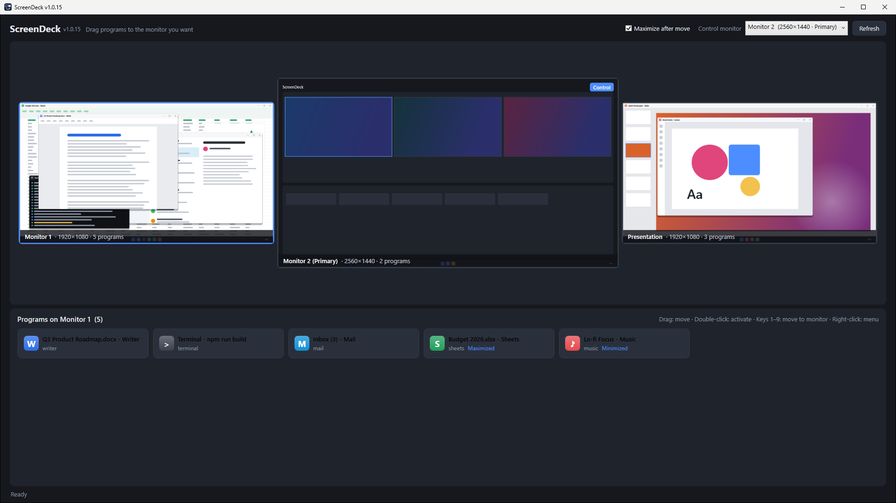
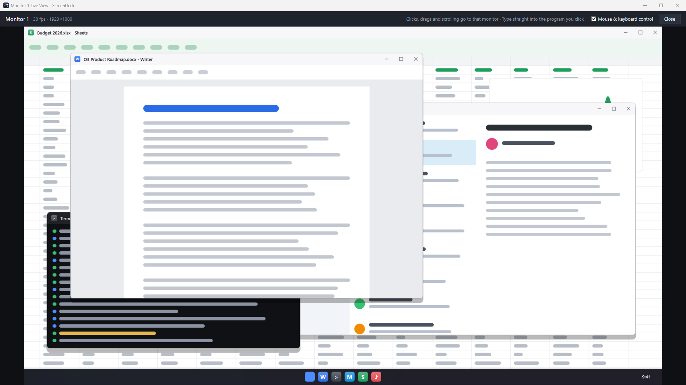

# ScreenDeck

**English** | [한국어](#한국어)

ScreenDeck is a Windows app for multi-monitor setups. Keep one screen as your **control monitor**, see every monitor live, and drag programs between monitors, or work on another monitor from where you sit.



## Features

- **Live layout of all monitors:** every monitor appears in its real arrangement with a live preview.
- **Drag and drop to move programs:** drag a program card onto another monitor to move it there (maximized by default).
- **Live view and control:** open another monitor enlarged on the control monitor. Clicks, double-clicks, drags and scrolling go to that monitor, and typing goes straight to the program you clicked.
- **Monitor names:** give each monitor a name. Names are saved and come back after a restart.
- **Borderless fullscreen windows** (video players, games) are moved to fill the target monitor.



## Getting started

1. Download from [Releases](https://github.com/MinaryHub/ScreenDeck/releases/latest): `ScreenDeck-Setup-<version>.exe` (installer) or `ScreenDeck.exe` (portable, no install). Windows 10/11 64-bit; no separate .NET install is needed.
2. On first start, the primary monitor becomes the control monitor. You can change it under **Control monitor** at the top right.
3. Click a monitor to list the programs running on it.
4. Drag a program card onto another monitor's preview to move it.

| Action | How |
|---|---|
| Move a program | Drag its card onto a monitor preview |
| Quick move | Select a card, press `1`–`9` |
| Bring to front | Double-click a card, or press `Enter` |
| Program menu | Right-click a card |
| Show where a window is | Hover over a card |
| Live view & control | Double-click a monitor, or right-click → **Live view & control** |
| Rename a monitor | Double-click its name, or right-click → **Rename...** |
| Keep size and position | Uncheck **Maximize after move** |


## Live view

- Shows the monitor at about 30 frames per second.
- Each click briefly moves the mouse pointer to the target monitor and back, since Windows has only one pointer.
- Uncheck **Mouse & keyboard control** for view only.
- Hover effects and tooltips don't appear in the live view. A drag is replayed when you release the button.

## Limitations

- Programs running as administrator can only be moved or controlled when ScreenDeck also runs as administrator.
- Exclusive fullscreen games may not move or appear in the live view.
- Protected video (DRM) shows as black in previews.

## Command-line options

| Option | Effect |
|---|---|
| `--demo` | Demo mode: fictional monitors and programs. Nothing on this PC is captured, moved or saved. |
| `--select N` | Select monitor `N` on start |
| `--live N` | Open the live view of monitor `N` on start |

## Files

- Settings (control monitor, monitor names): `%APPDATA%\ScreenDeck\settings.json`
- Error log: `%APPDATA%\ScreenDeck\crash.log`

## Building

Requires Windows and the .NET 9 SDK.

```powershell
# App + installer → dist\ScreenDeck.exe, dist\ScreenDeck-Setup-<version>.exe (needs Inno Setup 6)
.\build-installer.ps1

# Store screenshots (demo mode) → screenshots\
.\installer\make-screenshots.ps1

# App icon → src\ScreenDeck\ScreenDeck.ico
.\installer\make-icon.ps1
```

The version is `1.0.N`; `N` goes up by one on every build (`src/ScreenDeck/BuildNumber.txt`).

---

## 한국어

[English](#screendeck) | **한국어**

ScreenDeck은 여러 모니터를 쓰는 Windows 환경을 위한 앱입니다. 한 화면을 **제어 모니터**로 두고 모든 모니터를 실시간으로 보면서, 프로그램을 다른 모니터로 끌어다 옮기거나 다른 모니터를 제어 화면에서 직접 조작할 수 있습니다.

> 앱 화면은 영어로 되어 있습니다. 아래 설명의 굵은 글씨는 앱에 나오는 메뉴·버튼 이름입니다.

## 주요 기능

- **모든 모니터 배치를 실시간으로 표시:** 실제 배치 그대로 각 모니터의 화면을 미리보기로 보여 줍니다.
- **끌어다 놓아 프로그램 이동:** 프로그램 카드를 다른 모니터에 놓으면 그 모니터로 옮겨집니다(기본은 최대화).
- **확대 보기와 조작:** 다른 모니터를 제어 모니터에 크게 띄웁니다. 클릭, 더블클릭, 드래그, 스크롤이 그 모니터로 전달되고, 클릭한 프로그램에 바로 키보드 입력을 할 수 있습니다.
- **모니터 이름:** 모니터마다 이름을 붙일 수 있고, 다시 실행해도 유지됩니다.
- **테두리 없는 전체 화면 창**(영상 플레이어, 게임 등)은 대상 모니터 전체를 채우도록 옮겨집니다.

## 시작하기

1. [Releases](https://github.com/MinaryHub/ScreenDeck/releases/latest)에서 `ScreenDeck-Setup-<버전>.exe`(설치 파일) 또는 `ScreenDeck.exe`(설치 없이 바로 실행)를 내려받습니다. Windows 10/11 64비트에서 동작하며, .NET을 따로 설치할 필요는 없습니다.
2. 처음에는 주 모니터가 제어 모니터가 됩니다. 오른쪽 위 **Control monitor**에서 바꿀 수 있습니다.
3. 모니터를 클릭하면 그 모니터에서 실행 중인 프로그램 목록이 나옵니다.
4. 프로그램 카드를 다른 모니터 미리보기로 끌어다 놓으면 이동합니다.

| 기능 | 조작 |
|---|---|
| 프로그램 이동 | 카드를 모니터 미리보기로 드래그 |
| 빠른 이동 | 카드 선택 후 `1`–`9` |
| 앞으로 가져오기 | 카드 더블클릭 또는 `Enter` |
| 프로그램 메뉴 | 카드 우클릭 |
| 창 위치 확인 | 카드에 마우스 올리기 |
| 확대 보기·조작 | 모니터 더블클릭, 또는 우클릭 → **Live view & control** |
| 모니터 이름 바꾸기 | 이름 더블클릭, 또는 우클릭 → **Rename...** |
| 크기·위치 유지 | **Maximize after move** 체크 해제 |

## 확대 보기

- 모니터 화면을 초당 약 30프레임으로 보여 줍니다.
- Windows에는 마우스 포인터가 하나뿐이라, 클릭할 때마다 포인터가 대상 모니터로 아주 잠깐 갔다가 돌아옵니다.
- 보기만 하려면 **Mouse & keyboard control** 체크를 끕니다.
- 마우스를 올렸을 때의 강조 표시나 툴팁은 보이지 않습니다. 드래그는 버튼을 놓을 때 한 번에 재현됩니다.

## 제한 사항

- 관리자 권한으로 실행된 프로그램은 ScreenDeck도 관리자 권한으로 실행해야 옮기거나 조작할 수 있습니다.
- 독점 전체 화면(Exclusive fullscreen) 게임은 옮겨지지 않거나 확대 보기에 나오지 않을 수 있습니다.
- 저작권 보호(DRM) 영상은 미리보기에서 검게 보입니다.

## 실행 옵션

| 옵션 | 동작 |
|---|---|
| `--demo` | 데모 모드: 가상의 모니터와 프로그램을 보여 줍니다. 이 PC의 화면을 캡처하거나 창을 옮기거나 설정을 저장하지 않습니다. |
| `--select N` | 시작할 때 `N`번 모니터 선택 |
| `--live N` | 시작할 때 `N`번 모니터 확대 보기 열기 |

## 파일 위치

- 설정(제어 모니터, 모니터 이름): `%APPDATA%\ScreenDeck\settings.json`
- 오류 로그: `%APPDATA%\ScreenDeck\crash.log`

## 빌드

Windows와 .NET 9 SDK가 필요합니다.

```powershell
# 앱 + 설치 파일 → dist\ScreenDeck.exe, dist\ScreenDeck-Setup-<버전>.exe (Inno Setup 6 필요)
.\build-installer.ps1

# 스토어용 스크린샷(데모 모드) → screenshots\
.\installer\make-screenshots.ps1

# 앱 아이콘 → src\ScreenDeck\ScreenDeck.ico
.\installer\make-icon.ps1
```

버전은 `1.0.N` 형식이며, 빌드할 때마다 `N`이 1씩 올라갑니다(`src/ScreenDeck/BuildNumber.txt`).
